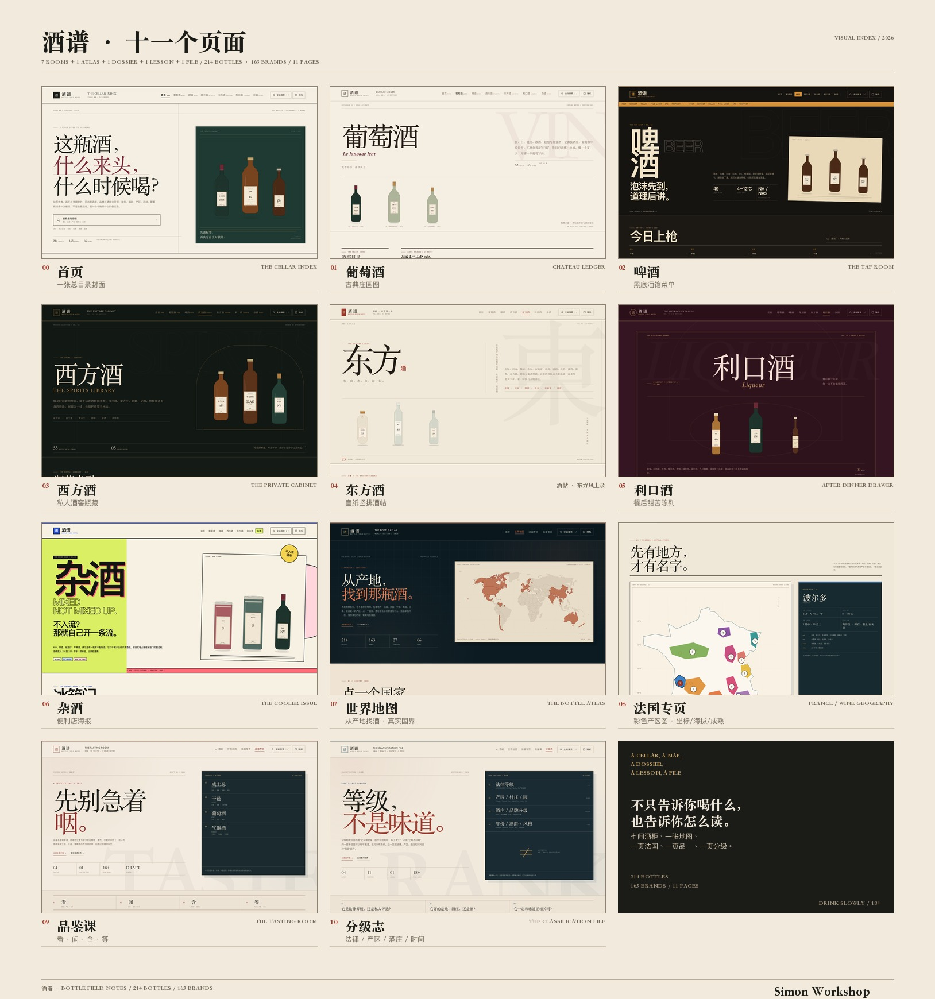

# 酒谱 · BOTTLE FIELD NOTES

「这瓶酒，什么来头，什么时候喝？」

给原创角色写手、画手和考据党用的一组纯静态酒类笔记。606 瓶酒，按 **7 个酒柜页面 + 世界地图 + 法国专页 + 品鉴课 + 分级志** 编排，共 **11 页**；品牌与酒款分开存，搜索按品牌聚合，详情共享同一只抽屉。动效也按页面分别写，但共用一套可降级的 motion engine。

## 这次不是模板换色

第一版（`screenshots/initial/`、`screenshots/final/`）是一套统一的酒柜卡片，所有分类页长得太像。当前版本把七页当作七次独立的编辑企划：

| 页面 | 视觉企划 | 版式与阅读方式 |
| --- | --- | --- |
| 首页 | **The Cellar Index** | 总目录封面、六间房的拼贴索引、今日酒 |
| 葡萄酒 | **Château Ledger** | 古典双线刊头、酒庄画廊、左侧酒窖目录、双列酒标档案 |
| 啤酒 | **The Tap Room** | 黑底酒馆、跑马灯、酒头菜单式横向条目 |
| 西方酒 | **The Private Cabinet** | 暗绿酒窖、黄铜线、拱形酒柜、三列瓶藏索引 |
| 东方酒 | **酒帖 · 东方风土录** | 宣纸、朱砂印、竖排题记、两栏书页式酒帖 |
| 利口酒 | **The After-Dinner Drawer** | 深梅色、椭圆金线、错落的珠宝式卡片 |
| 杂酒 | **The Cooler Issue** | 便利贴/冰柜海报、亮色块、黑描边、票签与跑马灯 |

七页共享同一套 **酒谱** 刊头语言与功能，但网格、字体、颜色、筛选呈现、卡片密度、分页样式和动效节奏各自独立。视觉总览：

## 本地预览

纯静态，无构建、无框架、无外部字体/图片。

```bash
cd /Users/bzhu/Downloads/酒谱alcohol_map
python3 -m http.server 8000
```

访问 <http://localhost:8000/>。也可以直接双击 `index.html`；所有资源都是相对路径，GitHub Pages 直接把整个目录作为站点根目录即可。

## 文件结构

```text
.
├── index.html / wine.html / beer.html / spirits.html
├── eastern.html / liqueur.html / mixed.html
├── map.html             世界地图：大洲 / 国家 / 产区入口
├── france.html          法国葡萄酒地理：产区、品种、酒种、贵腐菌
├── tasting.html         品鉴课：威士忌 / 干邑 / 葡萄酒 / 气泡酒
├── classification.html  分级志：AOC、DOCG、1855、AVA、干邑/雅文邑/威士忌
├── styles.css            shared reset + 全站搜索 / 详情抽屉 / A5 打印等共享 UI
├── favicon.svg
├── assets/wine-logo.svg   全站徽标（酒红底酒杯与葡萄）
├── inventory.svg         生成的 606 款库存总表（可直接打开/打印）
├── assets/world-mini.svg 首页地图入口用的真实世界轮廓（Natural Earth 1:110m）
├── css/
│   ├── core.css           v2 公共刊头、导航、页脚、筛选项、分页骨架与动效引擎
│   ├── atlas.css          世界地图 / 国家索引
│   ├── france.css         法国葡萄酒地理专页
│   ├── tasting.css        品鉴课页面
│   ├── classification.css  分级志页面
│   ├── home.css
│   ├── wine.css
│   ├── beer.css
│   ├── spirits.css
│   ├── eastern.css
│   ├── liqueur.css
│   └── mixed.css
├── app.js                 全站搜索、品牌目录、筛选、分页、抽屉、随机、打印、动效、回顶
├── js/
│   ├── atlas.js           地图：大洲筛选、国家/产区结果
│   ├── france.js          法国页动态酒款计数
│   ├── tasting.js         品鉴课目录高亮
│   └── classification.js  分级志目录高亮
├── data/bottles.js       606 条数据，由 <script> 挂到 window.BOTTLES
├── screenshots/
│   ├── redesign/         v2 终版：desktop / mobile / views / details、report.json、A5 PDF
│   ├── atlas/            地图 / 法国页截图与 report.json
│   ├── tasting/          品鉴课截图
│   ├── classification/   分级志截图
│   ├── motion/           动效验收：帘幕、指针光晕、悬停、搜索、抽屉、入场 GIF
│   ├── initial/          v1 · 13 瓶阶段存档
│   └── final/            v1 · 60 瓶统一版存档
├── scripts/
│   ├── build_pages.py
│   ├── build_inventory_svg.py
│   ├── check-v2.mjs
│   ├── check-all-v2.mjs
│   └── check-atlas.mjs
└── README.md
```

## 已实现功能

- **全站统一徽标**：`assets/wine-logo.svg` 用在 11 页的顶栏与页脚，桌面 40px、平板 38px、手机 36px；品牌链接仍保留「酒谱首页」的 `aria-label`。
- **7 个酒柜页面 + 世界地图 + 法国专页 + 品鉴课 + 分级志**，共享顶部导航与当前页高亮；地图、法国页、品鉴页和分级志使用各自的刊头。
- **全站搜索**：顶部搜索或 `/`、`Cmd/Ctrl+K` 打开；跨全部酒柜页面查询，结果按品牌聚合，点击跳到所属页面并打开详情。
- **按品牌搜索**：搜索首页新增品牌目录（格兰菲迪 7 款、尊尼获加 5 款等），点击品牌名直接展开；结果仍按品牌分组。
- **本页搜索**：每个分类页的搜索只筛当前分类。
- **分类筛选**：
  - 葡萄酒：类型、国家、葡萄品种、年份、甜度、价格、场景；
  - 啤酒：类型、国家、价格、场景；
  - 西方酒：类型、产区、酒龄、价格、场景；
  - 东方酒：国家/地区、类型、价格、场景；
  - 利口酒：类型、品牌、价格；
  - 杂酒：类型、价格。
- **分页**：每页 15 条，筛选后回到第 1 页，页码/前后翻页/结果区间都随页面风格重绘。
- **共享详情抽屉**：程序化 SVG 瓶型与酒标、关键数据、风味/香气、葡萄卡（酒庄、品种、早收/晚收、酸度/甜度）、场景、配餐、适饮温度、醒酒（只给香气复杂的酒款写）、传说、创作提示、常见误用。
- **深链接**：如 `wine.html#lafite-2016`；关闭抽屉会清掉 hash。
- **随机一瓶**：全站随机挑选并跳到对应页面打开。
- **A5 酒标卡打印**：详情内一键打印；实际导出的样张为单页 A5。
- **移动端**：390px 全站无横向滚动；窄屏采用各页自己的压缩策略（葡萄酒横向酒标、西方酒双列瓶藏、啤酒横向酒头、其余按各自版式）。
- **18+ / 理性饮酒**：只在页脚出现一次；没有健康功效表述。
- **共享的只有工具，不共享版式**：搜索、详情抽屉和打印由 `app.js` + `styles.css` 提供；每页的视觉由自己的 CSS 文件接管。
- **数据驱动的总数**：首页封面、页脚和分类页头的瓶数/品牌数由 `data/bottles.js` 自动计算，新增记录后无需手动改 606 / 407。

## 动效层

这一版把「页面切换」本身也当成版式的一部分：

- **七种入口帘幕**：每页有自己的一块满屏色布、编号、页名和英文短题，约 0.8 秒后向上滑走。纯 CSS 动画，不阻塞内容。
- **滚动进度与回顶**：顶部 2px 进度线使用当前页强调色；滚动超过一屏后出现 `TOP` 回顶按钮。
- **指针光晕**：啤酒、西方酒、利口酒三页有跟随鼠标的暖色光晕，深色背景下能看出酒窖灯光。
- **空间视差**：桌面端移动指针时，巨型背景字、幽灵字和代表酒瓶会做不同强度的位移；酒瓶还有极慢的上下浮动。
- **环境微尘**：每页 hero 会生成 20 个（移动端 10 个）不同速度的飘浮颗粒；啤酒是泡沫圈，利口酒是金色菱形，杂酒是彩色纸屑。
- **入场编排**：标题的 clip-path 显现、红色「酒」字盖章、酒瓶和艺术卡先后落位等，逐页不同。
- **滚动揭示**：首屏以下的编辑性段落用 `IntersectionObserver` 进入时淡入上移；键盘焦点进入时自动显示。
- **卡片流光与 3D 倾斜**：标签卡跟随鼠标出现柔光，瓶身会基于指针位置做很轻的 `rotateX/rotateY`。
- **搜索与抽屉**：搜索背景加 `backdrop-filter` 模糊，面板下落；抽屉打开时带背板模糊、ribbon 和酒瓶分层进入。
- **可关闭**：所有无限动画、帘幕、微尘、视差和揭示都会在 `prefers-reduced-motion: reduce` 下关闭，页面内容立即完整显示。

预览：[七个入口帘幕](screenshots/motion/overview-entrances.jpg) · [首页入场 GIF](screenshots/motion/home-entrance.gif) · [指针与悬停状态](screenshots/motion/)

## 世界地图与法国专页

- [map.html](map.html)：**真实国界世界地图**（Natural Earth 1:110m）。有酒的国家以陶土色高亮，可直接点击地图或国家卡片，显示该国全部酒款，再按产区收窄；法国条目直接连到专页。大洲筛选保留在国家索引顶部。首页「六只酒柜」之后新增了地图入口，页脚也有「世界地图」链接。
- [france.html](france.html)：法国葡萄酒地理专页。真实法国轮廓上的 **12 个彩色产区图**，含经纬网、产区编号和点击详情；每个产区给出代表坐标、海拔、成熟/采收窗口、气候/土壤、代表 AOC 与红白品种。下方另有 12 张数据卡、6 类酒种分布、5 个贵腐菌重点区，以及当前酒柜里的法国酒款数量。
- 首页世界地图下方新增一个双入口区「先学会喝，再学会看。」：左侧是**品鉴课**，右侧是**分级志**；两张整卡可点，取代了原来 HOUSE NOTES 下面的两行小链接。
- [tasting.html](tasting.html)：品鉴课。威士忌四步（选杯与观色、闻香、品味、余韵）与四种喝法；干邑的观色、闻香、口中停留与储存；葡萄酒的干红/干白/甜白；气泡酒三大流派、香槟甜度梯度、年份与开瓶方式。页末有速查表，并标注“待补”，方便后续继续补清酒、白酒、啤酒等章节。
- [classification.html](classification.html)：分级志。先把“法律等级、产区/园、酒庄名单、年份/酒龄”四层拆开；法国 AOC/AOP/IGP/VdF、波尔多 1855、勃艮第特级园、香槟村庄级；意大利 DOCG/DOC/IGT、西班牙 DOCa/DO/VP 与 Rioja 陈年、德国 Prädikat、葡萄牙 DOC/IGP；美国 AVA、澳洲 GI 等新世界产地体系；干邑 VS/VSOP/XO/Hors d'Age 与雅文邑、威士忌、龙舌兰的分级逻辑。页末有跨国产区/等级对照表和四个常见误读。

## 库存 SVG

根目录的 [inventory.svg](inventory.svg) 是一张由 `data/bottles.js` 直接生成的 606 款库存总表：按分类分栏，列出编号、品牌/酒款、类型、年份/酒龄、ABV 和参考价档。它不是截图，可以放大、搜索文字、直接打印，也可以当海报看。生成脚本是 `scripts/build_inventory_svg.py`，数据变了重跑即可。

## 数据

606 瓶 / 407 个品牌（本轮从 60 条扩到 606 条，净增 546 条）：

| 分类 | 数量 | 覆盖 |
| --- | ---: | --- |
| 葡萄酒 | 108 | 波尔多、勃艮第、香槟、意大利、美国、智利、德国雷司令、加拿大冰酒与加强酒；新增桃红、波特、雪莉、马德拉、贵腐、冰酒、橙酒 |
| 啤酒 | 55 | 中国日常拉格、小麦白啤、比利时修道院、德式小麦、兰比克、酸啤、世涛、IPA 等 |
| 西方酒 | 125 | 苏格兰、爱尔兰、日本威士忌，波本/黑麦、干邑、雅文邑、卡尔瓦多斯、苦艾酒、阿夸维特、格拉巴、梅斯卡尔、龙舌兰、朗姆、卡沙萨、皮斯科、金酒、伏特加 |
| 东方酒 | 102 | 中国（酱香、浓香、清香、凤香、黄酒）、日本（清酒/烧酎/泡盛/威士忌）、韩国、中东、东南亚、印度 |
| 利口酒 | 41 | 君度、百利甜、雪利、味美思（Martini / Carpano）、苦精、绿查特、金巴利 |
| 杂酒 | 175 | 预调、果酒、硬苏打、苹果酒；新增梨酒、茶梅酒、油柑酒、荔枝酒、李子起泡、黑莓酒、果味/气泡黄酒 |

品牌与酒款严格分开。例如 `brand: "格兰菲迪"` 的 7 条记录分别是 12、15、18、21、30、40、50 年；`brand: "尊尼获加"` 的 5 条是红牌、黑牌、绿牌、金牌、蓝牌。新增的青岛啤酒 7 条记录也按 1903、大绿棒子、原浆、散啤、奥古特、白啤、小棕瓶分开。

本轮又补入 14 款酒：路易王妃 Collection 243、罗曼尼康帝特级园 2019、巴黎之花美丽时光 2015、唐培里侬 P1 2013 / P2 2004 / P3 1993、云岭雷司令冰酒 2021、路易亚都科通查理曼特级园 2021、雅克塞洛斯 Initial、泰亭哲伯爵白中白 2013、圣朱塞佩布鲁奈罗库索 2019、沙龙贝尔桃红香槟、帕图斯 2016、拉图古堡正牌 2016、哈雪白中白香槟。

随后又搜入 25 款：木桐古堡 2016、白马古堡 2016、西施佳雅 2019、作品一号 2018、奔富 Grange 2018、库克 Grande Cuvée 171 版、沙龙 2013 香槟、伊贡穆勒沙兹堡雷司令 Auslese 2019、勒弗莱骑士-蒙哈榭 2020、拉雅教皇新堡 2016、乐加维林 16 年、知更鸟 12 年、响 21 年、六 金酒、外交官珍藏朗姆、康帝雍贵兹、奥瓦尔修道院啤酒、西弗莱特伦 12 号、俄罗斯河老普林尼、创始人 KBS 帝国世涛、十四代本丸秘伝玉返し、塔牌手工冬酿、剑南春水晶剑、查特绿酒、金巴利苦味开胃酒。

最后补入 5 款：海曼黑莓金酒、卡帕诺安提卡味美思（按用户要求放在利口酒）、澎魄 VO、布赫拉迪经典莱迪、保乐苦艾酒（苦爱酒按 absinthe 收录，归西方酒）。

家庭收藏补充 16 条：其中 **人头马 CLUB、人头马 XO Premier Cru、轩尼诗 XO** 已在库中，直接更新价格/表述；新增 13 款——Dean Estate 519 西拉 2010、奔富 St. Henri 西拉 1993、Ozzie Red Bin 103 西拉 2013、Cranford Bouquet 西拉 2008、木桐古堡 2015、普里厄古堡 2015、James Bin 18 西拉 2007、Gustave Lorentz 琼瑶浆特级园 2015、博姆-德沃尼斯麝香传统甜白、巴斯特-拉蒙塔涅 2018、人头马 V.S.O.P、帝王 12 年特醇、松竹梅清酒。

另按书页补入 5 家干邑：奥德里 Mémorial Fine Champagne 42°、巴吕埃 V.S.O.P.、保罗·博 Hors d'Age Vieille Grande Champagne、博龙城堡干邑、贝特朗父子 V.S.O.P.。这些没有可靠公开标价，暂时统一写“参考价待补 / 以酒庄报价为准”。

杂酒补充 21 款：Cidrerie de Verzy / Jérôme Forget 干型西洋梨气泡酒；蓬莱泉东方美人茶梅酒、包种茶柚子酒；梅侍红玉红茶、碧螺春、冻顶乌龙、红乌龙、荔枝梅酒；猫之惠红茶梅酒；国盛红茶梅酒；小花样油柑酒；大九酿造山野曼波油柑酸梅西打；MissBerry 香柠油柑酒；稍喜荔枝酒；首芳西瓜李 cider；富纯黑莓酒；夏日纷黑莓酒；即墨老酒嗨酷泡青梅/焦咖；会稽山一日一熏。

葡萄酒写 `vintage`，威士忌写 `age`，啤酒与多数预调酒写 `NV / NAS`。价格用参考区间，风味标记为品鉴参考。

### 后续扩写

- 新增酒款：往 `data/bottles.js` 追加对象即可。各分类数量、首页房间计数、页脚总数、筛选器、分页、全站搜索和品牌目录都会自动重算。
- 新增知识段落：直接写进对应页面的 HTML；想使用滚动揭示时，给该段落加 `data-reveal` 即可。
- 页面顶部仍有少量手工排的版式编号（`VOL.` 号、`ROOMS` / `PAGES`、期号等），它们是编辑文案，不是数据统计；需要与新增内容一起改。
- 新增品牌如果款数很多，会自动进入搜索空态的品牌目录（按款数排序取前 14 个）。
- 可选 `aliases` 字段：例如 `aliases: ["博龙", "柏龙"]`，搜索会把常见译名、连写和别名一起收进索引；`麦卡伦12`、`轩尼诗vsop` 这类不带空格的中英混写也能命中。

## 自检

- 7 页 × 1440 / 768 / 390 宽度：无横向溢出，无控制台报错。
- 6 个分类的筛选、全部页面本页搜索、跨页品牌搜索、分页、随机、深链接均已跑通。
- 606 瓶逐瓶打开抽屉检查：标题、数据、葡萄卡数量、打印卡标题全部匹配；无 `undefined` / `NaN`。
- 606 张 A5 酒标卡逐张生成检查：无溢出。
- 样例 PDF：[lafite-a5-print.pdf](screenshots/redesign/lafite-a5-print.pdf)，1 页，MediaBox 420 × 594.96 pt。
- 详细报告：[report.json](screenshots/redesign/report.json)；606 瓶逐瓶报告：[report-all.json](screenshots/redesign/report-all.json)。
- 动效双路径验收：正常动效下 0 console error；`prefers-reduced-motion` 下帘幕/微尘/光晕/揭示全部关闭，首屏内容立即可见；390px 仍无横向滚动。
- 库存 SVG：`inventory.svg` 由数据生成，包含全部 606 款；页面页脚有入口，SVG 本身可放大、搜索文字、打印。
- 地图 / 法国：`check-atlas.mjs` 验证 48 个国家、法国 83 款、地图国家点击、产区筛选、英文查询参数、768/390/1440 无横向溢出；报告 [screenshots/atlas/report.json](screenshots/atlas/report.json)。
- 品鉴课：`tasting.html` 在 1440/768/390 下检查目录、四步列表、三张葡萄酒卡与横向溢出；目录高亮和锚点均已验证。
- 分级志：`classification.html` 在 1440/768/390 下检查 5 个章节、目录高亮、法国金字塔/国家卡/对照表；无横向溢出，控制台错误 0。
- 地图国界数据：Natural Earth 1:110m（public domain，经 `world-atlas` 的 TopoJSON 转为 SVG）；法国页轮廓同源，产区点位仍是编辑示意。来源：<https://www.naturalearthdata.com/>。
- 截图：
  - [七页视觉总览](screenshots/redesign/overview-pages.jpg)
  - [七个入口帘幕](screenshots/motion/overview-entrances.jpg)、[首页入场 GIF](screenshots/motion/home-entrance.gif)、[减弱动效的静态回退](screenshots/motion/reduced-beer.png)
  - [动效验收图](screenshots/motion/)、[卡片悬停](screenshots/motion/wine-card-hover.png)
  - [桌面全页目录](screenshots/redesign/desktop/)、[移动端全页](screenshots/redesign/mobile/)、[首屏视图](screenshots/redesign/views/)
  - [详情与搜索截图](screenshots/redesign/details/)、[A5 打印卡](screenshots/redesign/details/print-a5.png)
  - [库存 SVG 预览](screenshots/redesign/inventory-preview-small.jpg)、[库存 SVG](inventory.svg)
  - [世界地图](screenshots/atlas/map-top.png)、[法国专页](screenshots/atlas/france-top.png)、[法国产区图](screenshots/atlas/france-map.png)、[地图完整页](screenshots/atlas/map-full.png)、[法国完整页](screenshots/atlas/france-full.png)
  - [首页双入口](screenshots/redesign/home-study-1440.png)
  - [全站徽标 / 顶栏](screenshots/redesign/logo-global-home-top.png)、[页脚](screenshots/redesign/logo-global-home-footer.png)
  - [品鉴课](screenshots/tasting/desktop-top.png)、[品鉴课完整页](screenshots/tasting/desktop-full.png)
  - [分级志](screenshots/classification/top.png)、[分级志完整页](screenshots/classification/full.png)

`scripts/` 中的检查脚本需要本机 Microsoft Edge 远程调试端口，不属于站点依赖；开发期使用，部署时删掉也不影响任何页面。

## 数据不确定项

- **所有价格**都是人民币参考区间，随市场、年份、汇率、渠道、批次变化；`price` 1–4 为站内相对分档，不是统一报价。高年份格兰菲迪、蓝牌、茅台等尤其只宜看作量级。
- **不同市场版本**可能在 ABV / 容量上不同：Arak El Massaya（按约 50% / 750ml 记录）、老僧 7 年（42.8%）、青岛 1903、尊尼获加蓝牌、美格、White Claw、梅见等。
- **本轮高价酒只给了酒庄名、没给年份/ cuvée 的，按代表款入档**：罗曼尼康帝 2019、帕图斯 2016、拉图正牌 2016、唐培里侬 P1 2013 / P2 2004 / P3 1993、巴黎之花美丽时光 2015、泰亭哲伯爵白中白 2013、圣朱塞佩库索 2019、科通查理曼按路易亚都 2021。它们不是唯一在售年份，也不是酒庄全部产品线；“路易王妃”按 Collection 243 记录，不是水晶（Cristal）；“雅克塞洛斯”按 Initial 记录，不是 Substance。
- **本轮批量补录的偏向**：`Super Bad Apple` 按约 15.5% 记录、`Bad Apple` 按约 10% 记录，实际以瓶标为准；劲酒按 35% / 125ml 的常见小瓶记录。
- **译名与款式映射**：捷皇按 Primátor Weizenbier 记录；艾帝达姆按 Inedit Damm 记录；博世纳乌奎尔按 Pilsner Urquell 记录；白熊按 Vedett Extra White 记录；马爹利鼎盛按 Distinction VSOP 记录。圣欧班王子按 2020 年苏玳批次记录，实际年份可能不同。
  - Inedit Damm：<https://www.damm.com/cervesa/inedit>
  - Primátor / 捷皇：<https://exhibitor.anuga-cn.com/index.php/zh-cn/showroom-2024/institutions/a29408>
  - 2 Towns Ciderhouse / Bad Apple：<https://2townsciderhouse.com/2024/03/07/2-towns-ciderhouse-unleashes-a-dark-delight-imperial-dark-cherry-bad-apple/>
  - Prince de Saint-Aubin：<https://m.wine-world.com/winery/yvon-mau/bed2766b-ca52-463e-aa72-a22ed3367e0a>
  - Dom Pérignon P2 2004：<https://onlineonly.christies.com.cn/s/fine-rare-wines-online-landmark-cellar/dom-perignon-p2-2004-6/223527>
  - Dom Pérignon P3 1993：<https://www.sothebys.com/en/buy/auction/2025/the-magnificent-cellar-of-a-gentleman/dom-perignon-p3-1993-1-bt>
  - San Giuseppe / Stella di Campalto：<https://www.bbr.com/producer-1043-san-giuseppe-tuscany>
  - Louis Jadot Corton-Charlemagne 2021：<https://www.frw.co.uk/product/612ec280010000000005937e/2021-corton-charlemagne-louis-jadot>
- **青岛啤酒的多个“款”**（大绿棒子、小棕瓶、原浆、散啤）有包装/销售形态差异，不全是不同配方；站内按可检索的消费形态分别立卡。
- **去重与归并**：旧数据里已有健力士、福佳白啤、智美蓝帽、轩尼诗 X.O、第八代五粮液，本轮没有重复立卡；`至美蓝帽` 作为智美蓝帽的常见误写进别名。`世涛啤酒` 是风格不是一款酒，未单独立卡；`珀亚拉整个酒厂` 先以代表款 Öö 立卡，后续可继续拆成多款。
- **译名**：White Claw、Monkey 47、Old Monk、Massaya、Cotswolds 等没有统一官方中文名，站内使用常见音译或保留英文。
- **Don Julio 1942** 瓶标是 NAS；站内不把“约 2.5 年”当作固定瓶标信息。
- **新补 5 款的口径**：海曼黑莓金酒按用户给定名称收录，具体瓶标/酒精度以实物为准；澎魄 VO 的英文名与酒厂信息待校，已在 notes 中注明；苦爱酒按苦艾酒（absinthe）收录，归西方酒；味美思新增 Carpano Antica，原有 Martini 仍保留在利口酒。
- **法国页的分布图是编辑示意**，不按 INAO 产量/面积统计；AOC 名称是代表性列表，不是法规全文。彩色产区色块不对应 AOC 边界；坐标取代表点，海拔、成熟/采收为常见范围，随年份与品种变化。
- 五家干邑的装瓶等级/酒龄按书页与常见产品选择，未给出价格的以“参考价待补”记录；A. E. Audry 的 Mémorial 标为 42°，其余按 40° 记录，实际以瓶标为准。
- 家庭收藏中 **Château Prieuré 2015** 的“穆利斯 / 圣埃美隆”按瓶标存在歧义，站内按梅洛/品丽珠右岸风格记录；**Muscat de Beaumes-de-Venise** 是 AOC 名而非单一酒庄，已按产区传统甜酒记录。
- **葡萄品种**只列主要品种，不写逐年精密混酿比例。
- **传说与品牌故事**为常见资料的压缩版本；涉及“最早”“发明”等强主张的地方已尽量弱化，正式出版建议逐条对照酒庄档案。
- 格兰菲迪 30 / 40 / 50 年的 43% / 44.6% / 43.8% ABV 已对照官方中文页面：
  - <https://www.glenfiddich.cn/all-products/time-reimagined-series/30-year-old-suspended-time>
  - <https://www.glenfiddich.cn/all-products/time-reimagined-series/40-year-old>
  - <https://www.glenfiddich.cn/all-products/time-reimagined-series/50-year-old>
- 其余酒款按公开常见资料整理，未逐瓶做官方理化数据核对。

---

18+ · 理性饮酒 · 未满 18 岁请勿饮酒  
© 2026 酒谱 · Bottle Field Notes · **Simon Workshop™**

## 上传到 GitHub / GitHub Pages

可以。这个项目是纯静态站点，不需要构建，仓库名用 `alcohol_map`，直接放在仓库根目录即可。

### 1. 新建仓库

在 GitHub 新建一个 **Public** 仓库：

- Repository name: `alcohol_map`
- 不要勾选 “Add a README file”“Add .gitignore”“Choose a license”
- 保持空仓库

### 2. 本地初始化并推送

```bash
cd "/Users/bzhu/Downloads/酒谱alcohol_map"

git init -b main
git config user.name "你的名字"
git config user.email "你的邮箱"

git add .
git commit -m "Initial commit: 酒谱 alcohol_map"
git remote add origin https://github.com/<你的用户名>/alcohol_map.git
git push -u origin main
```

如果 HTTPS 推送时要求密码，请使用 GitHub 的 **Personal Access Token**，或改用 SSH 地址 `git@github.com:<你的用户名>/alcohol_map.git`。

### 3. 打开 GitHub Pages

仓库页面 → **Settings → Pages**：

- Source: **Deploy from a branch**
- Branch: **main**
- Folder: **/ (root)**
- 保存

稍等片刻，站点地址就是：

```text
https://<你的用户名>.github.io/alcohol_map/
```

### 说明

- 所有页面使用相对路径，放在 `/alcohol_map/` 子路径下也能正常加载；不需要改路径。
- `.nojekyll` 已加入，GitHub Pages 不会用 Jekyll 处理这个站点。
- `.gitignore` 已排除 `.DS_Store` 等系统文件。
- 当前仓库文件总量约 37MB，主要是 `screenshots/`；GitHub 单文件上限 100MB，没有超过。
- 首页是 [index.html](index.html)，不需要额外的构建命令。
- 如果要自定义域名，再在 Pages 里加 `CNAME` 即可。

本地预览：

```bash
cd "/Users/bzhu/Downloads/酒谱alcohol_map"
python3 -m http.server 8000
# 打开 http://localhost:8000/
```
